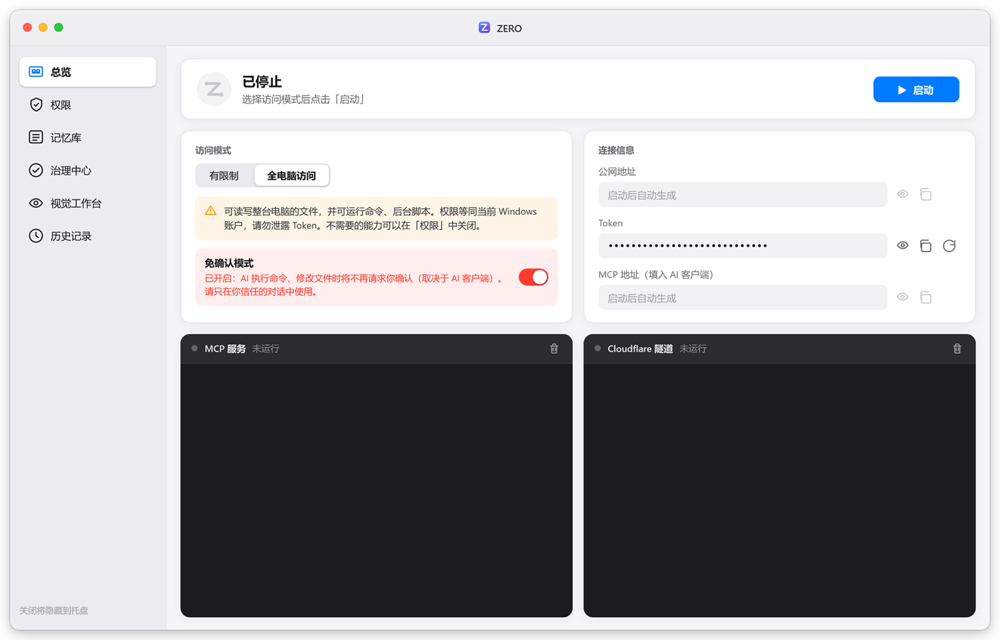
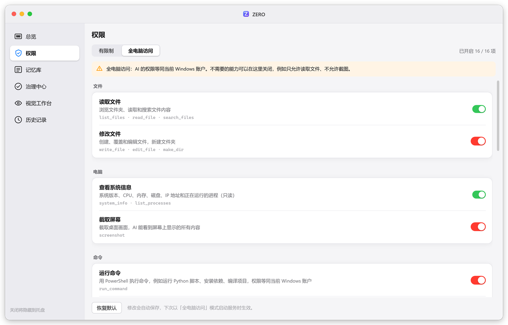
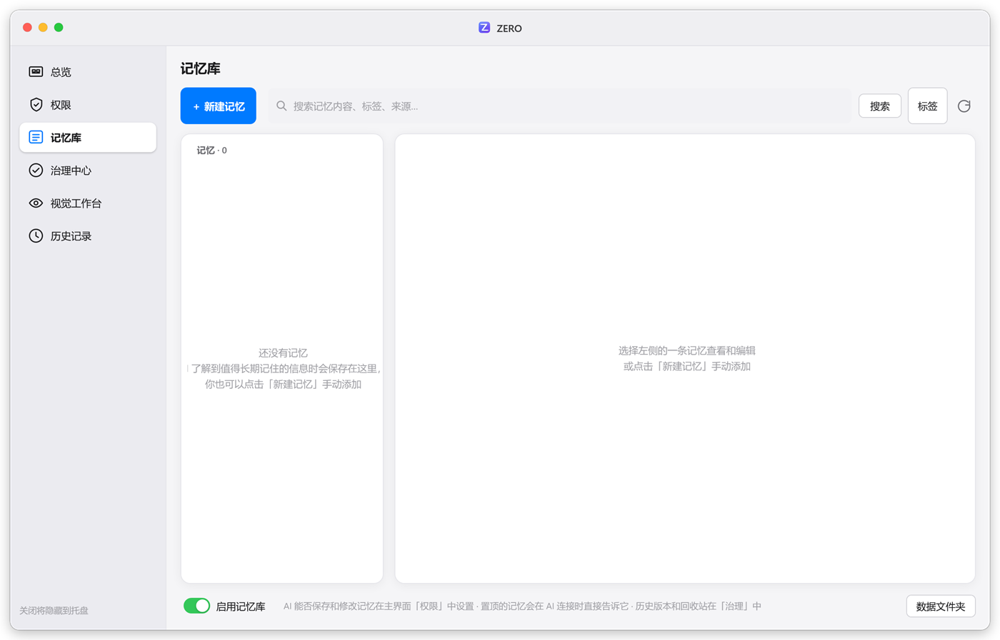
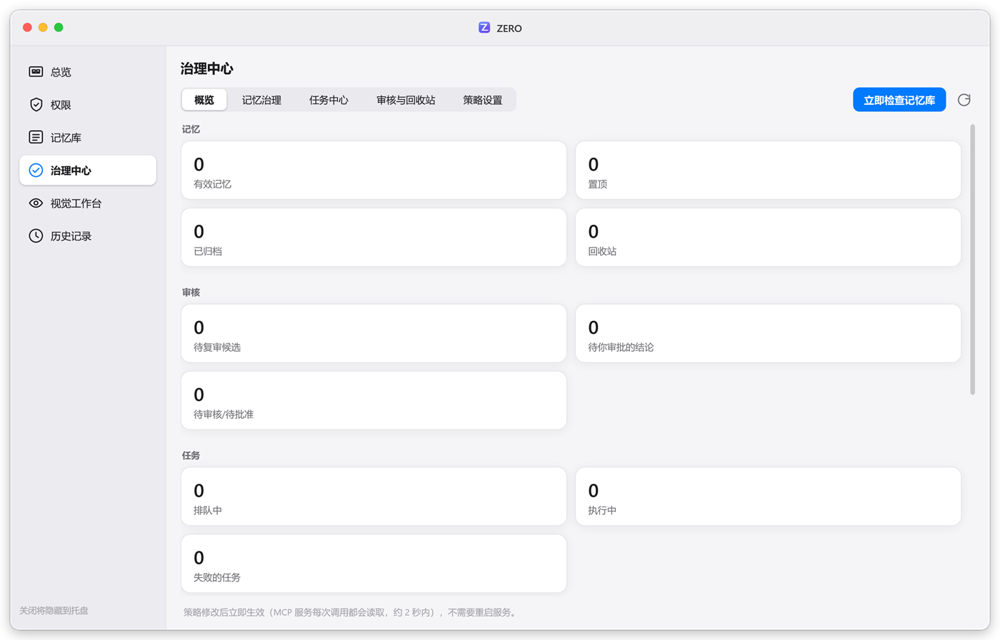
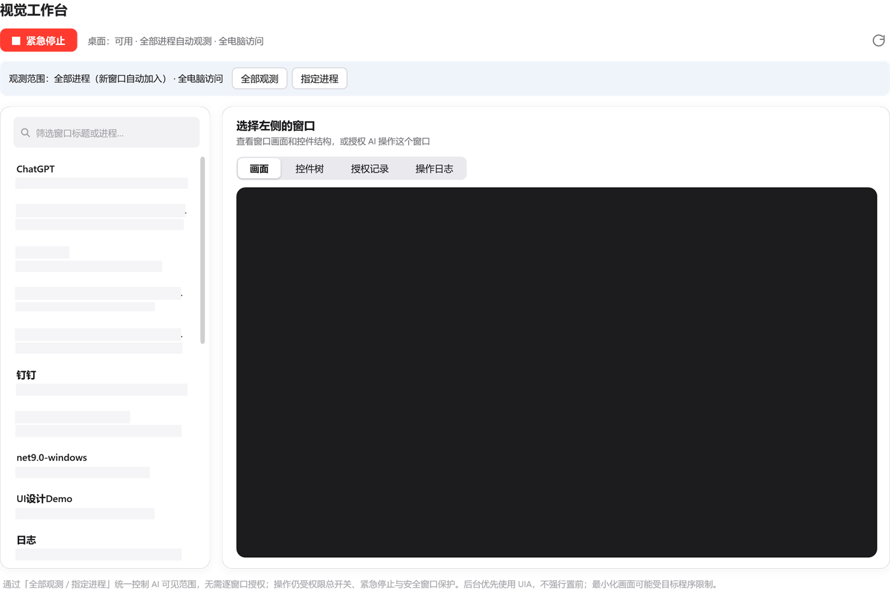
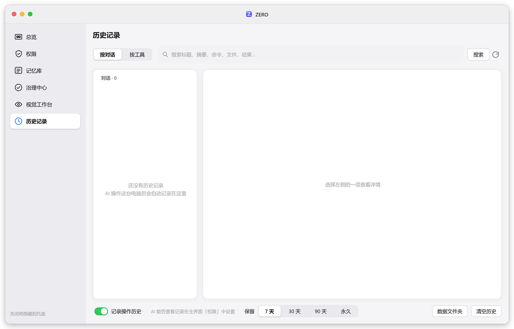

<p align="center">
  
</p>

<h1 align="center">ZERO</h1>

<p align="center">
  <b>零配置，把你的电脑变成 AI 可以调用的 MCP 服务</b><br>
  <sub>Zero-config bridge that turns your Windows PC into an MCP server for any AI assistant</sub>
</p>

<p align="center">
  <a href="https://github.com/gmc990406/LocalMCPZero/releases/latest/download/ZERO.exe"></a>
  <a href="https://github.com/gmc990406/LocalMCPZero/releases/latest"></a>
  <a href="#download"></a>
</p>

<p align="center">
  
  
  
  
</p>

<p align="center">
  <a href="#zh">中文</a> · <a href="#en">English</a> · <a href="#download">下载 / Download</a>
</p>

<a id="download"></a>

## 📥 下载 / Download

**当前版本 Current：[v1.3.0](https://github.com/gmc990406/LocalMCPZero/releases/latest)**

| | |
|---|---|
| 直接下载 Direct | [ZERO.exe](https://github.com/gmc990406/LocalMCPZero/releases/latest/download/ZERO.exe) |
| 大小 Size | ~67.3 MB（70,558,536 bytes） |
| SHA256 | `71F33DDB86F08E6AD70CB0B6FAA2219CABA04998ACFBC2E887020D6BECD5D479` |
| 全部版本 All releases | [Releases](https://github.com/gmc990406/LocalMCPZero/releases) |

<p align="center">
  
</p>

<p align="center">
  
  &nbsp;
  
</p>
<p align="center">
  
  &nbsp;
  
</p>
<p align="center">
  
</p>

---

<a id="zh"></a>

## 🇨🇳 中文

### 它解决什么问题？

云端 AI（Notion AI、Claude、ChatGPT 等）能写代码、能分析问题，但**碰不到你的电脑**：看不到本地文件、跑不了命令、也看不到你的屏幕。想让它们接入本机，通常要自己装 Python、写 MCP 服务、配置内网穿透、处理鉴权……步骤多、门槛高。

**ZERO 把这一切变成「双击 → 启动 → 复制地址」三步：**

| 痛点 | ZERO 的做法 |
|---|---|
| 要手动装 Python 和依赖 | 首次运行自动下载便携版 Python 与依赖，全部放在软件目录，**不改动系统** |
| 电脑没有公网 IP | 内置 Cloudflare 隧道，自动生成 HTTPS 公网地址，无需账号、无需路由器设置 |
| 担心被他人访问 | 地址自带随机 Token，无 Token 请求一律 401；可一键重新生成 |
| 不想让 AI 碰全部文件 | 「有限制」模式只开放一个工作目录，且禁止执行命令 |
| 只想给 AI 部分能力 | 「权限」里按模式逐项开关：只读不写、不许截图、不许运行命令… |
| 国内网络下载失败 | 多个下载源自动切换（NuGet → 国内镜像 → 官方源 → 本机 Python），失败原因写入日志 |

### 适用于哪些 AI？

任何支持 **远程 MCP（Streamable HTTP）** 的客户端都可以使用，例如：

- Notion AI（自定义 MCP 连接）
- Claude（桌面版 / 网页版自定义连接器）
- ChatGPT（支持 MCP 连接器的版本）
- Cursor、Windsurf、VS Code 等支持 MCP 的编辑器
- 其他兼容 MCP 协议的 Agent 框架

### 快速开始

1. **下载**：点击上方绿色按钮，或从 [最新 Release](https://github.com/gmc990406/LocalMCPZero/releases/latest/download/ZERO.exe) 下载 `ZERO.exe`，放到一个单独的文件夹里（详见 [下载](#download)）。
2. **运行**：双击启动，首次运行会自动准备环境（约 1–3 分钟，视网速而定）。
3. **选择模式**：
   - 🔒 **有限制** — 只能读写所选工作目录内的文件，不能执行命令（推荐新手）。
   - 🔓 **全电脑访问** — 可读写任意文件、执行 PowerShell 命令、运行后台任务、截取桌面。
4. **启动**：点击「启动」，等待 MCP 服务与隧道都变为绿色。
5. **连接 AI**：点击「MCP 地址」旁的复制按钮，把地址粘贴到 AI 客户端的「添加 MCP 服务 / 自定义连接器」中。
6. **开始使用**：直接对 AI 说，例如：
   - 「列出工作目录里的文件，并总结 README」
   - 「在桌面新建 todo.txt，写入今天的计划」
   - 「运行 `ipconfig` 告诉我本机 IP」（全电脑访问）
   - 「截一张桌面图，看看我的报错弹窗是什么意思」（全电脑访问）

> 💡 **小技巧**
> - 关闭窗口后 ZERO 会最小化到系统托盘继续运行；右键托盘图标可启动/停止、复制地址、打开日志或退出。
> - Token 输入框右侧的 🔄 按钮可重新生成 Token（旧地址立即失效）。
> - 命令行参数 `ZERO.exe --start` 会在环境就绪后自动启动服务，可放入「启动」文件夹实现开机自启。

### 界面（v1.3）

权限、记忆库、治理中心、视觉工作台、历史记录都收进**同一个主窗口**，左侧侧栏一键切换；关闭窗口会隐藏到托盘（托盘菜单也能打开各模块）。窗口宽度变化时会自动切换三档布局。

### 多会话与并发（v1.3）

多个 AI 客户端可以同时连接同一台 ZERO：

- **会话隔离**：任务、浏览器临时配置等按真实聊天 / MCP 会话归属；识别不到会话时按单次请求隔离，避免不同对话误共享状态。
- **并发调度**：读写、搜索、命令、记忆、窗口与浏览器工具分池限流，单个会话也有并发上限，避免某一 Agent 占满整台 ZERO。

### 提供的工具

| 工具 | 有限制 | 全电脑访问 | 说明 |
|---|:---:|:---:|---|
| `list_files` | ✅ | ✅ | 列出目录（可递归） |
| `read_file` | ✅ | ✅ | 读取文本文件（可指定行范围） |
| `search_files` | ✅ | ✅ | 正则全文搜索 |
| `write_file` / `edit_file` | ✅ | ✅ | 新建、覆盖或精确替换文本 |
| `make_dir` | ✅ | ✅ | 创建目录 |
| `system_info` | ⚙️ | ✅ | 系统、CPU、内存、磁盘、IP 等本机概况（只读） |
| `list_processes` | ⚙️ | ✅ | 进程列表，按内存排序（只读） |
| `run_command` | — | ✅ | 执行 PowerShell 命令（≤ 120 秒） |
| `start_job` / `job_status` / `list_jobs` / `stop_job` | — | ✅ | 后台长任务（编译、开发服务器等） |
| `screenshot` | ⚙️ | ✅ | 截取桌面并以图片返回 |
| `history_conversations` / `history_calls` | ✅ | ✅ | 查看历史对话与操作记录（只读） |
| `history_note` | ✅ | ✅ | AI 为当前对话写标题和摘要 |
| `memory_search` | ✅ | ✅ | 搜索记忆库（需启用记忆库） |
| `memory_save` / `memory_update` / `memory_delete` | ✅ | ✅ | 保存、修改记忆，移到回收站 |
| `memory_versions` | ✅ | ✅ | 查看记忆的历史版本 |
| `task_create` / `task_update` / `task_get` / `task_list` / `task_complete` | ✅ | ✅ | 登记多步任务的计划和进度 |
| `governance_status` / `governance_claim` / `governance_heartbeat` / `governance_submit` / `governance_release` | ✅ | ✅ | 领取并处理记忆维护任务 |
| `ui_list_windows` / `ui_inspect` / `ui_wait` / `ui_compare` / `ui_request_access` | ⚙️ | ✅ | 窗口列表、控件树、等待界面变化、截图比较、申请操作授权 |
| `ui_screenshot` / `ui_record` | ⚙️ | ✅ | 截取或录制单个窗口 |
| `ui_action` | ⚙️ | ⚙️ | 操作已授权窗口的控件（点击、输入、选择…） |
| `browser_open` / `browser_inspect` / `browser_close` | ⚙️ | ✅ | 用独立浏览器配置打开允许列表中的网页并查看 |
| `browser_action` | ⚙️ | ⚙️ | 在 AI 打开的网页里点击、输入、执行脚本 |

✅ 默认开启 · ⚙️ 默认关闭，可在「权限」中开启 · — 该模式下不可用。除 `history_note` 外，每一项都可以在「权限」中关闭。

### 🛡️ 权限

主界面点「权限」，可以**按访问模式分别**设置 AI 能用哪些能力，「有限制」和「全电脑访问」各有一套开关，互不影响：

| 权限 | 包含的工具 | 有限制 | 全电脑访问 |
|---|---|:---:|:---:|
| 读取文件 | `list_files` `read_file` `search_files` | 开 | 开 |
| 修改文件 | `write_file` `edit_file` `make_dir` | 开 | 开 |
| 查看系统信息 | `system_info` `list_processes` | 关 | 开 |
| 截取屏幕 | `screenshot` | 关 | 开 |
| 运行命令 | `run_command` | 不可用 | 开 |
| 后台任务 | `start_job` `job_status` `list_jobs` `stop_job` | 不可用 | 开 |
| 查看操作记录 | `history_conversations` `history_calls` | 开 | 开 |
| 搜索记忆 | `memory_search` | 开 | 开 |
| 保存和修改记忆 | `memory_save` `memory_update` `memory_delete` | 开 | 开 |
| 登记任务计划 | `task_*` | 开 | 开 |
| 处理记忆维护任务 | `governance_*` | 开 | 开 |
| 查看窗口和控件 | `ui_list_windows` `ui_inspect` `ui_wait` `ui_compare` `ui_request_access` | 关 | 开 |
| 窗口截图和录制 | `ui_screenshot` `ui_record` | 关 | 开 |
| 操作窗口控件 | `ui_action` | 关 | 关 |
| 打开和查看网页 | `browser_open` `browser_inspect` `browser_close` | 关 | 开 |
| 操作网页 | `browser_action` | 关 | 关 |

- 关闭的权限对应的工具**不会提供给 AI**；ZERO 还会在服务说明里告诉 AI 哪些权限被关闭了，需要时 AI 会提示你去「权限」里开启，而不是误以为电脑没有这个能力。
- 「有限制」模式下始终不能运行命令和后台任务（命令可以访问工作空间以外的任何文件）。
- 修改自动保存。服务运行中修改当前模式的权限时，点「重启服务使其生效」即可——只重启 MCP 服务，**公网地址不变**。ChatGPT 等会缓存工具列表的客户端需要在连接器设置里刷新（或新开对话）。

### 🕘 历史记录

ZERO 会把 AI 在这台电脑上的每一次工具调用记录到本机（`%LOCALAPPDATA%\ZERO\history.db`），**不同 AI（Notion AI、Claude、Gemini…）的操作都汇总在一起**，任何一个 AI 都能接着看之前做过什么。

- **按对话 / 按工具** 两种方式浏览：主界面点「历史记录」打开。
- **自动分组**：客户端提供聊天标识时（如 ChatGPT 的 `x-openai-session`）**按聊天分组**，同一个聊天的操作始终在一组，多个聊天同时进行也不会混；否则 ZERO 会给每次 MCP 连接签发会话标识（`Mcp-Session-Id`），回传该标识的客户端按 **MCP 会话** 分组；不回传的客户端按「同一客户端 + 30 分钟内」**推断**分组，界面会标注「推断」。AI 可以用 `history_note(new_conversation=true)` 新开一组，或用 `history_note(conversation_id=编号)` 接回同一个聊天之前的组；分错了可以在界面里「从这里拆分」或「合并到上一组」。参数校验失败、工具不存在等没有真正执行的调用也会记录为失败。
- **跟着电脑走**：历史和设置保存在当前 Windows 用户的 `%LOCALAPPDATA%\ZERO\`，与程序位置无关——更新 ZERO、移动或重新下载 exe 都不会丢失；数据库升级前会自动备份为 `history.db.bak-v1`。历史窗口底部「数据文件夹」可直接打开该目录。
- **自动标题**：AI 没写标题和摘要时，ZERO 根据操作自动生成（如「修改 macos.html」「查看 Create」），并在每组第一次操作的结果里提醒 AI 完成后用 `history_note` 写标题、摘要和要记住的信息；AI 或你改写后不再覆盖。
- **可编辑**：对话标题、摘要、每条记录的备注都可以修改（AI 查看历史时会读到这些内容）；可删除单条记录或整个对话，可置顶。
- **自动清理**：默认保留 30 天（可选 7 / 30 / 90 天或永久），置顶的对话不会被清理。
- **自动脱敏**：Token、密码、密钥（`password=…`、`Bearer …`、`ghp_…`、`sk-…` 等）在写入前替换为 `***`；超长参数和结果会截断。
- **隔离**：「有限制」模式下的 AI 只能看到「有限制」模式下的记录。
- 可以在历史窗口底部关闭「记录操作历史」；AI 能否查看记录在「权限」中设置。重新启动服务后生效。

> ZERO 只能看到 AI 调用了哪些工具，**看不到你和 AI 的聊天原文**；对话内容靠 AI 用 `history_note` 写的摘要补充。

### 🧠 记忆库

跨 AI 共享的长期记忆（`%LOCALAPPDATA%\ZERO\memory.db`，不随历史记录清理）：用户偏好、项目位置与约定、之前得出的结论等。

- AI 用 `memory_search` 搜索（开始任务前会先查），用 `memory_save` / `memory_update` / `memory_delete` 保存、修改、删除。完成任务时 AI 调用 `history_note`，可在 `memories` 参数里顺带写下本次值得长期记住的信息，自动存入记忆库。
- 主界面点「记忆库」查看和编辑：新建、修改内容和标签、按标签筛选、删除。
- **置顶**的记忆会在 AI 连接时直接写进服务说明（无需搜索），且 AI 不能删除。
- 每条记忆可设置可见范围：所有模式 / 仅全电脑访问 / 仅有限制模式（AI 保存时默认为当前模式）。
- 底部开关「启用记忆库」；AI 能否搜索、保存和修改记忆在「权限」中设置。重新启动服务后生效。保存时会自动去掉 Token、密码等敏感内容。
- 每次修改都保留历史版本；删除先进回收站，可在「治理中心 → 审核与回收站」恢复。打开「保护」的记忆不会被 AI 修改或删除。

### 🧭 治理中心

主界面点「治理」打开，帮你长期保持记忆库干净可靠：

- **定期检查**：ZERO 每 14 天（可调）用本地规则检查记忆库——完全重复、高度相似、可能冲突、长期未被检索、过长、已过期——**不调用任何 AI 模型、不花钱**，只生成「候选」。
- **AI 协助、你来决定**：连接的 AI 空闲时可以领取维护任务（`governance_claim`）并提交结论；保留、降权这类低风险结论按策略自动生效，合并、更正、归档、删除需要你在「记忆治理」中批准。你也可以不等 AI，直接处理候选。
- **任务中心**：AI 登记的多步任务（`task_create`）和维护任务都在这里，可以查看进度和事件、批准、取消或重新排队。
- **策略设置**：任务模式（轻量 / 标准 / 严格）、检查周期和阈值、自动生效范围、浏览器允许列表等，保存后立即生效。
- 详细说明（数据结构、迁移与回滚、错误码）见 [docs/governance](docs/governance/README.md)。

### 👁️ 视觉工作台

主界面点「视觉」打开，让 AI 能看懂并（在你授权后）操作其他程序：

- AI 可以列出窗口、读取控件结构（UI Automation）、截取或录制单个窗口、比较两次截图（需要「查看窗口和控件」「窗口截图和录制」权限）。
- 操作控件需要开启「操作窗口控件」权限，**并且**在视觉工作台为具体窗口限时授权（15 / 30 / 60 分钟）；AI 也可以用 `ui_request_access` 申请，ZERO 会在托盘提醒你批准。
- **紧急停止**按钮立即拒绝所有界面操作；所有操作都有审计日志。密码框、UAC / 登录等安全窗口和 ZERO 自己的窗口始终禁止。
- 浏览器工具用独立的临时配置启动 Edge / Chrome，默认只允许访问本机地址（可在策略中加入其他主机），关闭后自动删除配置。

主界面下方的日志面板会自动清理 30 分钟前的内容。

### 🔕 免确认模式

很多 AI 客户端（如 Gemini、Claude、Notion AI）在调用会修改电脑的工具前会弹出「允许 / 拒绝」确认框。这是因为 ZERO 按照 MCP 规范，**如实**把 `run_command`、`write_file` 等工具标记为 `destructiveHint: true`。

如果你觉得频繁确认很麻烦，可以在「全电脑访问」模式下打开 **免确认模式** 开关（默认关闭）：

| | 默认 | 免确认模式 |
|---|---|---|
| 只读工具（读文件、截图、系统信息…） | `readOnlyHint: true` | `readOnlyHint: true` |
| 修改类工具（命令、写文件、后台任务…） | `readOnlyHint: false`, `destructiveHint: true` | `readOnlyHint: true`, `destructiveHint: false` |

- 开关只在服务**停止**时可切换，下次启动生效；切换后需要在 AI 客户端中**重新连接**，让它重新读取工具信息。
- 是否真的跳过确认由 AI 客户端决定，部分客户端会忽略这些提示。
- 「有限制」模式不受此开关影响。
- 不需要执行命令时，优先使用 `system_info`、`list_processes` 等真正只读的工具，它们默认就不需要确认。

> ⚠️ 开启后，如果 AI 读到网页、文件或邮件里隐藏的恶意指令（提示注入），可能在你不知情的情况下执行危险命令。请只在你信任的对话中开启，用完及时关闭。

### ⚠️ 安全须知

- **MCP 地址 = 钥匙。** 在「全电脑访问」模式下，拿到地址的人可以以当前用户身份完全控制这台电脑。不要截图、不要分享；怀疑泄露请立即点 Token 旁的 🔄 重新生成。
- 软件配置目录（含 Token）受保护，AI 无法通过 MCP 读取。
- 「免确认模式」会让 AI 直接执行命令而不经你确认，默认关闭，请谨慎开启。
- 历史记录可能包含文件内容和命令输出。开启「允许 AI 查看历史」后，连接到 ZERO 的 AI 都能读到同一模式下的记录；历史中的文字可能来自网页或文件，ZERO 会提示 AI 不要把它当作指令。
- 不用时请点击「停止」或退出软件，隧道会随之关闭。

### 常见问题

<details>
<summary><b>重启软件后 AI 连不上了？</b></summary>

Cloudflare 快速隧道每次启动都会分配新域名，请重新复制 MCP 地址并在 AI 客户端中更新连接。
</details>

<details>
<summary><b>环境准备失败怎么办？</b></summary>

点击「打开日志」，查看 `logs\ZERO.log`。日志会记录每个下载地址的 HTTP 状态码、耗时和异常信息。公司网络可设置系统代理后点「重试」。
</details>

<details>
<summary><b>截屏失败或是黑屏？</b></summary>

截屏需要电脑处于已登录、未锁屏的桌面会话；远程桌面断开或最小化时无法截屏。
</details>

<details>
<summary><b>会不会影响我电脑里已有的 Python？</b></summary>

不会。ZERO 使用自己的便携 Python，放在软件目录 `runtime\` 下；删除软件文件夹即可完全清除。
</details>

### 从源码构建

**环境**：Visual Studio 2022（17.12+，「.NET 桌面开发」工作负载）或 .NET 9 SDK。

- **Visual Studio**：打开 `ZERO.sln`，按 `F5` 调试。
- **命令行**（推荐，不写入 `src\ZERO\bin`）：

```powershell
powershell -ExecutionPolicy Bypass -File .\build.ps1 [-Mode Test|Release]
```

| 模式 | 输出 |
|---|---|
| `Test`（默认） | Debug 产物 → `%TEMP%\zbuild` |
| `Release` | 单文件自包含发布 → `release\v<Version>\`（当前为 `release\v1.3.0\`） |

| 调试用环境变量 | 作用 |
|---|---|
| `NB_SKIP_NUGET=1` | 跳过 NuGet 下载，测试嵌入版 Python 安装流程 |
| `NB_SKIP_SYSTEM=1` | 跳过「使用本机 Python」回退方案 |

---

<a id="en"></a>

## 🇺🇸 English

### What problem does it solve?

Cloud AI assistants (Notion AI, Claude, ChatGPT, …) can write code and reason about problems, but **they can't touch your computer** — no local files, no commands, no screen. Wiring them up usually means installing Python, writing an MCP server, setting up a tunnel and handling auth yourself.

**ZERO reduces all of that to three steps: double-click → Start → copy the URL.**

| Pain point | How ZERO handles it |
|---|---|
| Installing Python & dependencies | Downloads a portable Python and dependencies on first run, all inside the app folder — **your system stays untouched** |
| No public IP | Built-in Cloudflare Quick Tunnel gives you an HTTPS URL; no account or router setup needed |
| Unauthorized access | Every URL carries a random token; requests without it get `401`. Regenerate any time |
| Don't want AI to see everything | **Restricted** mode exposes a single workspace folder and disables command execution |
| Only want to grant some capabilities | **Permissions** lets you toggle each capability per mode: read-only, no screenshots, no commands… |
| Downloads fail on some networks | Multiple mirrors with automatic fallback; every failure is logged with details |

### Which AI clients are supported?

Any client that supports **remote MCP over Streamable HTTP**, for example:

- Notion AI (custom MCP connection)
- Claude (custom connectors)
- ChatGPT (MCP connectors)
- Cursor, Windsurf, VS Code and other MCP-enabled editors
- Any MCP-compatible agent framework

### Quick start

1. **Download** `ZERO.exe` via the green button above, or from the [Latest Release](https://github.com/gmc990406/LocalMCPZero/releases/latest/download/ZERO.exe), and put it in its own folder (see [Download](#download)).
2. **Run** it. The first launch prepares the runtime automatically (1–3 minutes depending on your network).
3. **Choose a mode**:
   - 🔒 **Restricted** — read/write files in the selected workspace only, no commands (recommended).
   - 🔓 **Full access** — any file, PowerShell commands, background jobs and screenshots.
4. Click **Start** and wait until both the MCP server and the tunnel turn green.
5. **Copy the MCP URL** and paste it into your AI client's "Add MCP server / custom connector" dialog.
6. **Just ask**, e.g.:
   - "List the files in my workspace and summarize the README."
   - "Create todo.txt on my desktop with today's plan."
   - "Run `ipconfig` and tell me my IP address." (full access)
   - "Take a screenshot and explain the error dialog on my screen." (full access)

> 💡 **Tips**
> - Closing the window minimizes ZERO to the system tray. Right-click the tray icon to start/stop, copy the URL, open logs or quit.
> - The 🔄 button next to the Token field regenerates the token (the old URL stops working immediately).
> - `ZERO.exe --start` starts the service automatically once the runtime is ready — put a shortcut in the Startup folder to launch on boot.

### UI (v1.3)

Permissions, Memory, Governance, Vision and History live in **one main window** with a left sidebar. Closing the window hides to the tray (tray menu opens each module). The layout switches across three size tiers as you resize.

### Multi-session & concurrency (v1.3)

Multiple AI clients can talk to the same ZERO at once:

- **Session isolation**: tasks and temporary browser profiles belong to a real chat / MCP session; unidentified calls stay per-request so conversations do not share state by accident.
- **Parallel scheduler**: read/write/search/command/memory/UI/browser tools run in separate pools with per-session caps, so one Agent cannot saturate ZERO.

### Tools

| Tool | Restricted | Full access | Description |
|---|:---:|:---:|---|
| `list_files` | ✅ | ✅ | List a directory (optionally recursive) |
| `read_file` | ✅ | ✅ | Read a text file (optional line range) |
| `search_files` | ✅ | ✅ | Regex full-text search |
| `write_file` / `edit_file` | ✅ | ✅ | Create, overwrite or precisely edit text |
| `make_dir` | ✅ | ✅ | Create a directory |
| `system_info` | ⚙️ | ✅ | OS, CPU, memory, disks, IP and uptime (read-only) |
| `list_processes` | ⚙️ | ✅ | Running processes sorted by memory (read-only) |
| `run_command` | — | ✅ | Run a PowerShell command (≤ 120 s) |
| `start_job` / `job_status` / `list_jobs` / `stop_job` | — | ✅ | Long-running background jobs |
| `screenshot` | ⚙️ | ✅ | Capture the desktop and return it as an image |
| `history_conversations` / `history_calls` | ✅ | ✅ | Browse past conversations and tool calls (read-only) |
| `history_note` | ✅ | ✅ | Let the AI write a title and summary for the current conversation |
| `memory_search` | ✅ | ✅ | Search the memory library (when memory is enabled) |
| `memory_save` / `memory_update` / `memory_delete` | ✅ | ✅ | Save and edit memories, move to trash |
| `memory_versions` | ✅ | ✅ | Version history of a memory |
| `task_create` / `task_update` / `task_get` / `task_list` / `task_complete` | ✅ | ✅ | Register plans and progress of multi-step tasks |
| `governance_status` / `governance_claim` / `governance_heartbeat` / `governance_submit` / `governance_release` | ✅ | ✅ | Claim and process memory maintenance tasks |
| `ui_list_windows` / `ui_inspect` / `ui_wait` / `ui_compare` / `ui_request_access` | ⚙️ | ✅ | Window list, control tree, wait for UI changes, compare captures, request control access |
| `ui_screenshot` / `ui_record` | ⚙️ | ✅ | Capture or record a single window |
| `ui_action` | ⚙️ | ⚙️ | Operate controls of a window you granted (click, type, select…) |
| `browser_open` / `browser_inspect` / `browser_close` | ⚙️ | ✅ | Open allow-listed pages in an isolated browser profile and inspect them |
| `browser_action` | ⚙️ | ⚙️ | Click, type and run scripts in the page the AI opened |

✅ on by default · ⚙️ off by default, can be enabled in Permissions · — not available in this mode. Everything except `history_note` can be turned off in Permissions.

### 🛡️ Permissions

Click "权限" (Permissions) in the main window to choose which capabilities the AI gets — **separately for each access mode**. Restricted and full access each have their own set of switches:

| Permission | Tools | Restricted | Full access |
|---|---|:---:|:---:|
| Read files | `list_files` `read_file` `search_files` | on | on |
| Modify files | `write_file` `edit_file` `make_dir` | on | on |
| System info | `system_info` `list_processes` | off | on |
| Screenshot | `screenshot` | off | on |
| Run commands | `run_command` | n/a | on |
| Background jobs | `start_job` `job_status` `list_jobs` `stop_job` | n/a | on |
| View history | `history_conversations` `history_calls` | on | on |
| Search memory | `memory_search` | on | on |
| Save & edit memory | `memory_save` `memory_update` `memory_delete` | on | on |
| Register tasks | `task_*` | on | on |
| Memory maintenance | `governance_*` | on | on |
| View windows & controls | `ui_list_windows` `ui_inspect` `ui_wait` `ui_compare` `ui_request_access` | off | on |
| Window capture & recording | `ui_screenshot` `ui_record` | off | on |
| Operate window controls | `ui_action` | off | off |
| Open & view web pages | `browser_open` `browser_inspect` `browser_close` | off | on |
| Operate web pages | `browser_action` | off | off |

- Tools of a disabled permission are **not offered to the AI**. ZERO also tells the AI which permissions are off, so it asks you to enable them instead of assuming the computer can't do it.
- Restricted mode can never run commands or background jobs (a command can reach files outside the workspace).
- Changes are saved automatically. While the service is running, click "重启服务使其生效" (restart to apply) — only the MCP server restarts and **the public URL stays the same**. Clients that cache tool lists (e.g. ChatGPT) need a refresh in their connector settings (or a new chat).

### 🕘 History

ZERO records every tool call made on this PC to a local database (`%LOCALAPPDATA%\ZERO\history.db`). **Calls from different AI clients (Notion AI, Claude, Gemini…) are kept together**, so any AI can pick up where another left off.

- **Automatic titles**: if the AI doesn't write a title/summary, ZERO generates them from the operations (e.g. "修改 macos.html") and reminds the AI once per group to call `history_note`; AI or user edits are never overwritten.
- **Browse by conversation or by tool**: click "历史记录" (History) in the main window.
- **Automatic grouping**: when the client provides a chat ID (e.g. ChatGPT's `x-openai-session`), calls are **grouped per chat**, even when several chats run at once. Otherwise ZERO issues an `Mcp-Session-Id` on every MCP connection. Clients that echo it are grouped by **MCP session**; others are grouped by *inferred* activity (same client within 30 minutes), marked "推断" in the UI. An AI can start a new group with `history_note(new_conversation=true)` or reattach to an earlier group of the same chat with `history_note(conversation_id=N)`; you can split or merge groups in the UI. Calls rejected before running (validation errors, unknown tools) are recorded as failures too.
- **Stays with the PC**: history and settings live in the current Windows user's `%LOCALAPPDATA%\ZERO\`, independent of where the exe is — updating, moving or re-downloading ZERO keeps them. The database is backed up to `history.db.bak-v1` before schema upgrades. Use "数据文件夹" (Data folder) at the bottom of the history window to open it.
- **Editable**: conversation titles, summaries and per-call notes (AI clients read these); delete single calls or whole conversations; pin important ones.
- **Retention**: 30 days by default (7 / 30 / 90 days or forever); pinned conversations are never cleaned up.
- **Redaction**: tokens, passwords and keys (`password=…`, `Bearer …`, `ghp_…`, `sk-…`, etc.) are replaced with `***` before saving; long arguments and results are truncated.
- **Isolation**: an AI in restricted mode only sees records from restricted mode.
- "Record history" can be turned off at the bottom of the history window; whether AI can view history is set in Permissions. Takes effect after restarting the service.

> ZERO only sees which tools were called — **it never sees your chat messages**. Conversation context comes from the summaries AI clients write with `history_note`.

### 🧠 Memory

Long-term memory shared by all AI clients (`%LOCALAPPDATA%\ZERO\memory.db`, never auto-cleaned): user preferences, project locations and conventions, earlier conclusions.

- AIs use `memory_search` (before starting a task) and `memory_save` / `memory_update` / `memory_delete`.
- Click "记忆库" (Memory) in the main window to browse, add, edit, tag-filter and delete memories.
- **Pinned** memories are included in the server instructions on every connection (no search needed) and cannot be deleted by AI.
- Each memory has a visibility scope: all modes / full access only / restricted only (AI-saved memories default to the current mode).
- Switch: "Enable memory"; whether AI can search / save / edit memories is set in Permissions. Takes effect after restarting the service. Tokens and passwords are scrubbed on save.
- Every change keeps a version; deletions go to the trash and can be restored in "治理中心 → 审核与回收站". **Protected** memories cannot be edited or deleted by AI.

### 🧭 Governance center

Click "治理" (Governance) in the main window:

- **Periodic review**: every 14 days (configurable) ZERO checks the memory library with local rules — exact duplicates, near duplicates, possible conflicts, never retrieved, too long, expired. **No AI model is called and nothing costs money**; it only creates *candidates*.
- **AI helps, you decide**: connected AIs can claim maintenance tasks when idle (`governance_claim`) and submit conclusions. Low-risk ones (keep, lower priority) apply automatically per policy; merge, correct, archive and delete need your approval. You can also handle candidates yourself.
- **Task center**: multi-step tasks registered by AI (`task_create`) and maintenance tasks, with progress, events, approve / cancel / requeue.
- **Policy**: task mode (light / standard / strict), review cycle and thresholds, auto-apply scope, browser allow list — effective immediately after saving.
- Details (schema, migration & rollback, error codes): [docs/governance](docs/governance/README.md).

### 👁️ Vision workbench

Click "视觉" (Vision) in the main window:

- AI can list windows, read the control tree (UI Automation), capture or record a single window and compare captures (permissions "View windows & controls", "Window capture & recording").
- Operating controls needs the "Operate window controls" permission **and** a time-limited grant (15 / 30 / 60 min) for that specific window in the workbench; AI can request one with `ui_request_access` and ZERO notifies you from the tray.
- **Emergency stop** rejects all UI actions immediately; every action is audited. Password fields, UAC / sign-in windows and ZERO's own windows are always off-limits.
- Browser tools launch Edge / Chrome with an isolated temporary profile, allowing only local addresses by default (add hosts in Policy); the profile is deleted on close.

The log panels in the main window automatically drop entries older than 30 minutes.

### 🔕 No-confirmation mode

Many AI clients (Gemini, Claude, Notion AI, …) show an "Allow / Deny" prompt before calling tools that can change your computer. That's because ZERO **honestly** marks tools such as `run_command` and `write_file` with `destructiveHint: true`, as the MCP spec intends.

If the prompts get in your way, turn on **No-confirmation mode** (off by default, full-access mode only):

| | Default | No-confirmation mode |
|---|---|---|
| Read-only tools (read files, screenshot, system info…) | `readOnlyHint: true` | `readOnlyHint: true` |
| Modifying tools (commands, file writes, jobs…) | `readOnlyHint: false`, `destructiveHint: true` | `readOnlyHint: true`, `destructiveHint: false` |

- The switch can only be changed while the service is **stopped** and applies on the next start. **Reconnect** your AI client afterwards so it re-reads the tool list.
- Whether prompts are actually skipped is up to the client — some ignore these hints.
- Restricted mode is never affected.
- For inspection tasks, prefer genuinely read-only tools like `system_info` and `list_processes`, which never need confirmation.

> ⚠️ With this mode on, a prompt injection hidden in a web page, file or email could make the AI run dangerous commands without asking you. Only enable it in conversations you trust, and turn it off afterwards.

### ⚠️ Security

- **The MCP URL is a key.** In full-access mode, anyone who has it can fully control this PC as the current user. Never share it; click 🔄 next to the Token field if you suspect a leak.
- ZERO's own config folder (where the token lives) is protected from MCP access.
- No-confirmation mode lets the AI run commands without asking you. It's off by default — enable it with care.
- History may contain file contents and command output. With "Allow AI to view history" on, every AI connected to ZERO can read records from the same mode. Text in history may come from web pages or files; ZERO tells the AI not to treat it as instructions.
- Click **Stop** or quit the app when you don't need it — the tunnel closes with it.

### FAQ

<details>
<summary><b>The AI can't connect after I restarted ZERO</b></summary>

Quick Tunnels get a new hostname on every start. Copy the new MCP URL and update the connection in your AI client.
</details>

<details>
<summary><b>Runtime setup failed</b></summary>

Click **Open log** and check `logs\ZERO.log`. It records the HTTP status, timing and exception for every download source. Behind a corporate network, configure the system proxy and click **Retry**.
</details>

<details>
<summary><b>Screenshots fail or are black</b></summary>

Screenshots require a signed-in, unlocked desktop session. They don't work while the PC is locked or a Remote Desktop session is disconnected/minimized.
</details>

<details>
<summary><b>Will it affect my existing Python installation?</b></summary>

No. ZERO uses its own portable Python under `runtime\` in the app folder. Delete the folder to remove everything.
</details>

### Build from source

**Requirements**: Visual Studio 2022 (17.12+, ".NET desktop development" workload) or the .NET 9 SDK.

- **Visual Studio**: open `ZERO.sln` and press `F5`.
- **Command line** (preferred; does not write into `src\ZERO\bin`):

```powershell
powershell -ExecutionPolicy Bypass -File .\build.ps1 [-Mode Test|Release]
```

| Mode | Output |
|---|---|
| `Test` (default) | Debug build → `%TEMP%\zbuild` |
| `Release` | single-file self-contained → `release\v<Version>\` (currently `release\v1.3.0\`) |

| Debug env var | Effect |
|---|---|
| `NB_SKIP_NUGET=1` | Skip NuGet to test the embeddable-Python install path |
| `NB_SKIP_SYSTEM=1` | Skip the "use system Python" fallback |

---

## 🧩 How it works · 工作原理

```
 AI client (Notion AI / Claude / ChatGPT / Cursor …)
        │  HTTPS  https://xxxx.trycloudflare.com/<TOKEN>/mcp
        ▼
 Cloudflare Quick Tunnel ──► cloudflared ──► 127.0.0.1:8766
                                              └─ server.py  (FastMCP · Streamable HTTP)
                                                   ├─ file tools · system_info · list_processes
                                                   ├─ PowerShell / background jobs
                                                   ├─ screenshot (GDI)
                                                   └─ history ──► %LOCALAPPDATA%\ZERO\history.db (SQLite)
                                                                   ▲
                                         ZERO 历史窗口 · History window ┘
```

`server.py` can also run standalone · 也可脱离界面单独运行：

```powershell
pip install "mcp<2" uvicorn
$env:MCP_TOKEN = "<random string, 24+ chars>"; $env:MCP_MODE = "restricted"   # or "full"
python src\ZERO\Resources\server.py
```

| Variable | 说明 · Description |
|---|---|
| `MCP_TOKEN` | 访问密钥（≥ 24 位） · Access token (24+ chars) |
| `MCP_MODE` | `restricted` / `full` |
| `MCP_TRUST` | `1` = 免确认模式（仅 `full` 有效） · no-confirmation mode (`full` only) |
| `MCP_WORKSPACE` | 有限制模式的工作目录 · Workspace for restricted mode |
| `MCP_PORT` | 本地端口，默认 8766 · Local port (default 8766) |
| `MCP_JOBDIR` | 后台任务日志目录 · Background job log folder |
| `MCP_PROTECT` | 禁止访问的目录（`;` 分隔） · Protected folders (`;`-separated) |
| `MCP_HISTORY_DB` | 历史数据库路径，为空则不记录 · History database path (empty = off) |
| `MCP_PERMS` | 允许的权限（逗号分隔）：`file_read,file_write,system,screenshot,command,jobs,history,memory_read,memory_write`；未设置时使用默认值 · enabled permissions (comma-separated); defaults when unset |
| `MCP_HISTORY_SHARE` | `1` = 允许 AI 查看历史 · allow AI to read history |
| `MCP_MEMORY_DB` | 记忆库路径，为空则不启用 · memory database path (empty = off) |
| `MCP_MEMORY_WRITE` | `1` = 允许 AI 写入记忆 · allow AI to save/edit memories |
| `MCP_REQLOG` | 诊断：最近 300 个请求的请求头与 `_meta`（不含 Token/Cookie/正文）· diagnostics: headers and `_meta` of the last 300 requests |

## 📁 Project structure · 项目结构

```
ZERO/
├─ ZERO.sln
├─ build.ps1                      一键发布 · one-click publish
├─ assets/                        Logo 与截图 · logo & screenshots
├─ docs/governance/               治理中心与视觉工作台说明 · governance & vision docs
└─ src/ZERO/
   ├─ App.xaml(.cs)               启动、单实例、全局样式 · startup, single instance, styles
   ├─ MainWindow.xaml(.cs)        单主壳侧栏导航与托盘 · single-shell sidebar & tray
   ├─ HistoryWindow.xaml(.cs)     历史记录窗口 · history window
   ├─ MemoryWindow.xaml(.cs)      记忆库窗口 · memory window
   ├─ PermissionWindow.xaml(.cs)  权限窗口 · permissions window
   ├─ GovernanceWindow.xaml(.cs)  治理中心 · governance center
   ├─ VisionWindow.xaml(.cs)      视觉工作台 · vision workbench
   ├─ Controls/ZeroDialog.xaml    统一风格的对话框 · styled dialogs
   ├─ Services/
   │  ├─ EnvironmentSetup.cs      运行环境自动安装 · runtime auto-setup
   │  ├─ ManagedProcess.cs        子进程管理（Job Object） · child processes
   │  ├─ AppSettings.cs           配置 · settings (%LOCALAPPDATA%\ZERO)
   │  ├─ HistoryStore.cs          历史记录数据库 · history database (SQLite)
   │  ├─ MemoryStore.cs           记忆库数据库 · memory database (SQLite)
   │  ├─ Permissions.cs           权限定义与默认值 · permission definitions & defaults
   │  ├─ SchemaMigrator.cs        数据库迁移（备份 + 事务） · schema migration
   │  ├─ GovernanceStore.cs       治理数据与策略 · governance data & policy
   │  ├─ UiaProvider.cs           UI Automation / 截图 / 输入（--uia-helper 子进程） · UIA helper
   │  └─ AppLog.cs                文件日志 · file logging
   ├─ Resources/
   │  ├─ server.py                MCP 服务（嵌入资源） · MCP server (embedded)
   │  ├─ zero_gov.py              记忆治理与任务 · memory governance & tasks
   │  ├─ zero_ui.py               视觉工作台与浏览器工具 · window & browser tools
   │  ├─ zero_schema.json         数据库结构与策略默认值 · schema & policy defaults
   │  └─ app.ico
   └─ Properties/PublishProfiles/win-x64.pubxml
```

## 📄 License · 许可证

[MIT](LICENSE) © GMC
