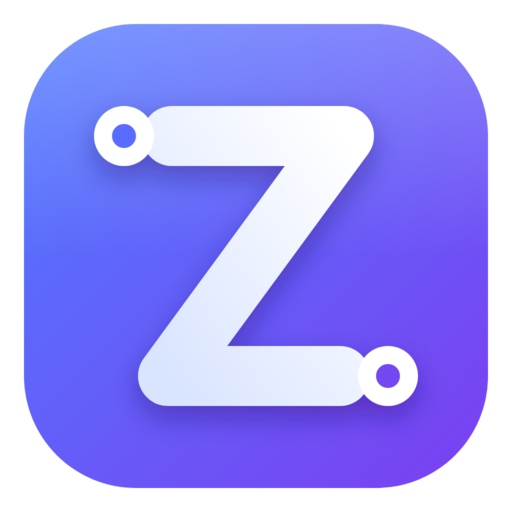
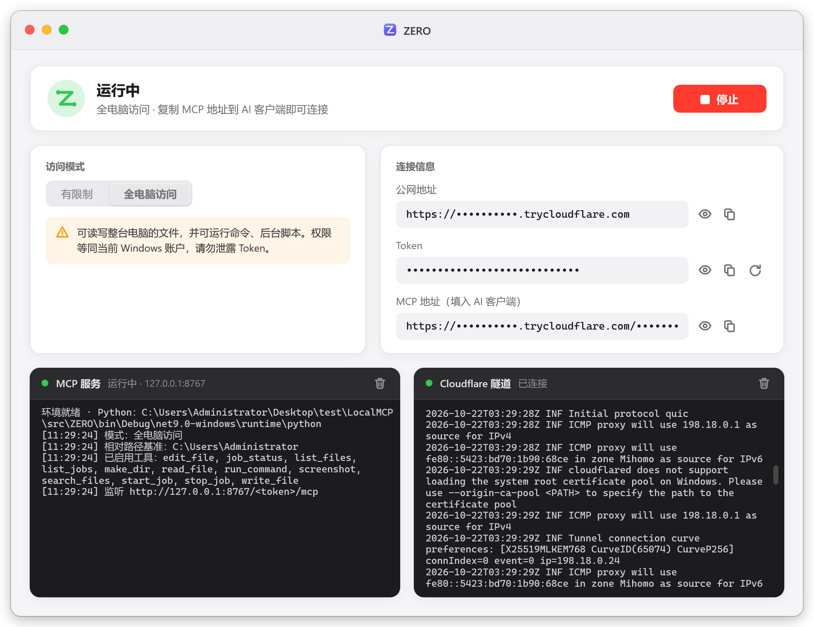

<p align="center">
  
</p>

<h1 align="center">ZERO</h1>

<p align="center">
  <b>零配置，把你的电脑变成 AI 可以调用的 MCP 服务</b><br>
  <sub>Zero-config bridge that turns your Windows PC into an MCP server for any AI assistant</sub>
</p>

<p align="center">
  
  
  
  
</p>

<p align="center">
  <a href="#zh">中文</a> · <a href="#en">English</a>
</p>

<p align="center">
  
</p>

---

<a id="zh"></a>

## 🇨🇳 中文

### 它解决什么问题？

云端 AI（Notion AI、Claude、ChatGPT 等）能写代码、能分析问题，但**碰不到你的电脑**：看不到本地文件、跑不了命令、也看不到你的屏幕。想让它们接入本机，通常要自己装 Python、写 MCP 服务、配置内网穿透、处理鉴权……步骤多、门槛高。

**ZERO 把这一切变成「双击 → 启动 → 复制地址」三步：**

| 痛点 | ZERO 的做法 |
|---|---|
| 要手动装 Python 和依赖 | 首次运行自动下载便携版 Python 与依赖，全部放在软件目录，**不改动系统** |
| 电脑没有公网 IP | 内置 Cloudflare 隧道，自动生成 HTTPS 公网地址，无需账号、无需路由器设置 |
| 担心被他人访问 | 地址自带随机 Token，无 Token 请求一律 401；可一键重新生成 |
| 不想让 AI 碰全部文件 | 「有限制」模式只开放一个工作目录，且禁止执行命令 |
| 国内网络下载失败 | 多个下载源自动切换（NuGet → 国内镜像 → 官方源 → 本机 Python），失败原因写入日志 |

### 适用于哪些 AI？

任何支持 **远程 MCP（Streamable HTTP）** 的客户端都可以使用，例如：

- Notion AI（自定义 MCP 连接）
- Claude（桌面版 / 网页版自定义连接器）
- ChatGPT（支持 MCP 连接器的版本）
- Cursor、Windsurf、VS Code 等支持 MCP 的编辑器
- 其他兼容 MCP 协议的 Agent 框架

### 快速开始

1. **下载**：从 [Releases](../../releases) 下载 `ZERO.exe`，放到一个单独的文件夹里。
2. **运行**：双击启动，首次运行会自动准备环境（约 1–3 分钟，视网速而定）。
3. **选择模式**：
   - 🔒 **有限制** — 只能读写所选工作目录内的文件，不能执行命令（推荐新手）。
   - 🔓 **全电脑访问** — 可读写任意文件、执行 PowerShell 命令、运行后台任务、截取桌面。
4. **启动**：点击「启动」，等待 MCP 服务与隧道都变为绿色。
5. **连接 AI**：点击「MCP 地址」旁的复制按钮，把地址粘贴到 AI 客户端的「添加 MCP 服务 / 自定义连接器」中。
6. **开始使用**：直接对 AI 说，例如：
   - 「列出工作目录里的文件，并总结 README」
   - 「在桌面新建 todo.txt，写入今天的计划」
   - 「运行 `ipconfig` 告诉我本机 IP」（全电脑访问）
   - 「截一张桌面图，看看我的报错弹窗是什么意思」（全电脑访问）

> 💡 **小技巧**
> - 关闭窗口后 ZERO 会最小化到系统托盘继续运行；右键托盘图标可启动/停止、复制地址、打开日志或退出。
> - Token 输入框右侧的 🔄 按钮可重新生成 Token（旧地址立即失效）。
> - 命令行参数 `ZERO.exe --start` 会在环境就绪后自动启动服务，可放入「启动」文件夹实现开机自启。

### 提供的工具

| 工具 | 有限制 | 全电脑访问 | 说明 |
|---|:---:|:---:|---|
| `list_files` | ✅ | ✅ | 列出目录（可递归） |
| `read_file` | ✅ | ✅ | 读取文本文件（可指定行范围） |
| `search_files` | ✅ | ✅ | 正则全文搜索 |
| `write_file` / `edit_file` | ✅ | ✅ | 新建、覆盖或精确替换文本 |
| `make_dir` | ✅ | ✅ | 创建目录 |
| `system_info` | — | ✅ | 系统、CPU、内存、磁盘、IP 等本机概况（只读） |
| `list_processes` | — | ✅ | 进程列表，按内存排序（只读） |
| `run_command` | — | ✅ | 执行 PowerShell 命令（≤ 120 秒） |
| `start_job` / `job_status` / `list_jobs` / `stop_job` | — | ✅ | 后台长任务（编译、开发服务器等） |
| `screenshot` | — | ✅ | 截取桌面并以图片返回 |

### 🔕 免确认模式

很多 AI 客户端（如 Gemini、Claude、Notion AI）在调用会修改电脑的工具前会弹出「允许 / 拒绝」确认框。这是因为 ZERO 按照 MCP 规范，**如实**把 `run_command`、`write_file` 等工具标记为 `destructiveHint: true`。

如果你觉得频繁确认很麻烦，可以在「全电脑访问」模式下打开 **免确认模式** 开关（默认关闭）：

| | 默认 | 免确认模式 |
|---|---|---|
| 只读工具（读文件、截图、系统信息…） | `readOnlyHint: true` | `readOnlyHint: true` |
| 修改类工具（命令、写文件、后台任务…） | `readOnlyHint: false`, `destructiveHint: true` | `readOnlyHint: true`, `destructiveHint: false` |

- 开关只在服务**停止**时可切换，下次启动生效；切换后需要在 AI 客户端中**重新连接**，让它重新读取工具信息。
- 是否真的跳过确认由 AI 客户端决定，部分客户端会忽略这些提示。
- 「有限制」模式不受此开关影响。
- 不需要执行命令时，优先使用 `system_info`、`list_processes` 等真正只读的工具，它们默认就不需要确认。

> ⚠️ 开启后，如果 AI 读到网页、文件或邮件里隐藏的恶意指令（提示注入），可能在你不知情的情况下执行危险命令。请只在你信任的对话中开启，用完及时关闭。

### ⚠️ 安全须知

- **MCP 地址 = 钥匙。** 在「全电脑访问」模式下，拿到地址的人可以以当前用户身份完全控制这台电脑。不要截图、不要分享；怀疑泄露请立即点 Token 旁的 🔄 重新生成。
- 软件配置目录（含 Token）受保护，AI 无法通过 MCP 读取。
- 「免确认模式」会让 AI 直接执行命令而不经你确认，默认关闭，请谨慎开启。
- 不用时请点击「停止」或退出软件，隧道会随之关闭。

### 常见问题

<details>
<summary><b>重启软件后 AI 连不上了？</b></summary>

Cloudflare 快速隧道每次启动都会分配新域名，请重新复制 MCP 地址并在 AI 客户端中更新连接。
</details>

<details>
<summary><b>环境准备失败怎么办？</b></summary>

点击「打开日志」，查看 `logs\ZERO.log`。日志会记录每个下载地址的 HTTP 状态码、耗时和异常信息。公司网络可设置系统代理后点「重试」。
</details>

<details>
<summary><b>截屏失败或是黑屏？</b></summary>

截屏需要电脑处于已登录、未锁屏的桌面会话；远程桌面断开或最小化时无法截屏。
</details>

<details>
<summary><b>会不会影响我电脑里已有的 Python？</b></summary>

不会。ZERO 使用自己的便携 Python，放在软件目录 `runtime\` 下；删除软件文件夹即可完全清除。
</details>

### 从源码构建

**环境**：Visual Studio 2022（17.12+，「.NET 桌面开发」工作负载）或 .NET 9 SDK。

- **Visual Studio**：打开 `ZERO.sln`，按 `F5` 调试；右键项目 →「发布」→ 选择 `win-x64` 配置，输出 `dist\ZERO.exe`。
- **命令行**：

```powershell
powershell -ExecutionPolicy Bypass -File .\build.ps1
```

| 调试用环境变量 | 作用 |
|---|---|
| `NB_SKIP_NUGET=1` | 跳过 NuGet 下载，测试嵌入版 Python 安装流程 |
| `NB_SKIP_SYSTEM=1` | 跳过「使用本机 Python」回退方案 |

---

<a id="en"></a>

## 🇺🇸 English

### What problem does it solve?

Cloud AI assistants (Notion AI, Claude, ChatGPT, …) can write code and reason about problems, but **they can't touch your computer** — no local files, no commands, no screen. Wiring them up usually means installing Python, writing an MCP server, setting up a tunnel and handling auth yourself.

**ZERO reduces all of that to three steps: double-click → Start → copy the URL.**

| Pain point | How ZERO handles it |
|---|---|
| Installing Python & dependencies | Downloads a portable Python and dependencies on first run, all inside the app folder — **your system stays untouched** |
| No public IP | Built-in Cloudflare Quick Tunnel gives you an HTTPS URL; no account or router setup needed |
| Unauthorized access | Every URL carries a random token; requests without it get `401`. Regenerate any time |
| Don't want AI to see everything | **Restricted** mode exposes a single workspace folder and disables command execution |
| Downloads fail on some networks | Multiple mirrors with automatic fallback; every failure is logged with details |

### Which AI clients are supported?

Any client that supports **remote MCP over Streamable HTTP**, for example:

- Notion AI (custom MCP connection)
- Claude (custom connectors)
- ChatGPT (MCP connectors)
- Cursor, Windsurf, VS Code and other MCP-enabled editors
- Any MCP-compatible agent framework

### Quick start

1. **Download** `ZERO.exe` from [Releases](../../releases) and put it in its own folder.
2. **Run** it. The first launch prepares the runtime automatically (1–3 minutes depending on your network).
3. **Choose a mode**:
   - 🔒 **Restricted** — read/write files in the selected workspace only, no commands (recommended).
   - 🔓 **Full access** — any file, PowerShell commands, background jobs and screenshots.
4. Click **Start** and wait until both the MCP server and the tunnel turn green.
5. **Copy the MCP URL** and paste it into your AI client's "Add MCP server / custom connector" dialog.
6. **Just ask**, e.g.:
   - "List the files in my workspace and summarize the README."
   - "Create todo.txt on my desktop with today's plan."
   - "Run `ipconfig` and tell me my IP address." (full access)
   - "Take a screenshot and explain the error dialog on my screen." (full access)

> 💡 **Tips**
> - Closing the window minimizes ZERO to the system tray. Right-click the tray icon to start/stop, copy the URL, open logs or quit.
> - The 🔄 button next to the Token field regenerates the token (the old URL stops working immediately).
> - `ZERO.exe --start` starts the service automatically once the runtime is ready — put a shortcut in the Startup folder to launch on boot.

### Tools

| Tool | Restricted | Full access | Description |
|---|:---:|:---:|---|
| `list_files` | ✅ | ✅ | List a directory (optionally recursive) |
| `read_file` | ✅ | ✅ | Read a text file (optional line range) |
| `search_files` | ✅ | ✅ | Regex full-text search |
| `write_file` / `edit_file` | ✅ | ✅ | Create, overwrite or precisely edit text |
| `make_dir` | ✅ | ✅ | Create a directory |
| `system_info` | — | ✅ | OS, CPU, memory, disks, IP and uptime (read-only) |
| `list_processes` | — | ✅ | Running processes sorted by memory (read-only) |
| `run_command` | — | ✅ | Run a PowerShell command (≤ 120 s) |
| `start_job` / `job_status` / `list_jobs` / `stop_job` | — | ✅ | Long-running background jobs |
| `screenshot` | — | ✅ | Capture the desktop and return it as an image |

### 🔕 No-confirmation mode

Many AI clients (Gemini, Claude, Notion AI, …) show an "Allow / Deny" prompt before calling tools that can change your computer. That's because ZERO **honestly** marks tools such as `run_command` and `write_file` with `destructiveHint: true`, as the MCP spec intends.

If the prompts get in your way, turn on **No-confirmation mode** (off by default, full-access mode only):

| | Default | No-confirmation mode |
|---|---|---|
| Read-only tools (read files, screenshot, system info…) | `readOnlyHint: true` | `readOnlyHint: true` |
| Modifying tools (commands, file writes, jobs…) | `readOnlyHint: false`, `destructiveHint: true` | `readOnlyHint: true`, `destructiveHint: false` |

- The switch can only be changed while the service is **stopped** and applies on the next start. **Reconnect** your AI client afterwards so it re-reads the tool list.
- Whether prompts are actually skipped is up to the client — some ignore these hints.
- Restricted mode is never affected.
- For inspection tasks, prefer genuinely read-only tools like `system_info` and `list_processes`, which never need confirmation.

> ⚠️ With this mode on, a prompt injection hidden in a web page, file or email could make the AI run dangerous commands without asking you. Only enable it in conversations you trust, and turn it off afterwards.

### ⚠️ Security

- **The MCP URL is a key.** In full-access mode, anyone who has it can fully control this PC as the current user. Never share it; click 🔄 next to the Token field if you suspect a leak.
- ZERO's own config folder (where the token lives) is protected from MCP access.
- No-confirmation mode lets the AI run commands without asking you. It's off by default — enable it with care.
- Click **Stop** or quit the app when you don't need it — the tunnel closes with it.

### FAQ

<details>
<summary><b>The AI can't connect after I restarted ZERO</b></summary>

Quick Tunnels get a new hostname on every start. Copy the new MCP URL and update the connection in your AI client.
</details>

<details>
<summary><b>Runtime setup failed</b></summary>

Click **Open log** and check `logs\ZERO.log`. It records the HTTP status, timing and exception for every download source. Behind a corporate network, configure the system proxy and click **Retry**.
</details>

<details>
<summary><b>Screenshots fail or are black</b></summary>

Screenshots require a signed-in, unlocked desktop session. They don't work while the PC is locked or a Remote Desktop session is disconnected/minimized.
</details>

<details>
<summary><b>Will it affect my existing Python installation?</b></summary>

No. ZERO uses its own portable Python under `runtime\` in the app folder. Delete the folder to remove everything.
</details>

### Build from source

**Requirements**: Visual Studio 2022 (17.12+, ".NET desktop development" workload) or the .NET 9 SDK.

- **Visual Studio**: open `ZERO.sln` and press `F5`. To publish, right-click the project → **Publish** → `win-x64` profile; output goes to `dist\ZERO.exe`.
- **Command line**:

```powershell
powershell -ExecutionPolicy Bypass -File .\build.ps1
```

| Debug env var | Effect |
|---|---|
| `NB_SKIP_NUGET=1` | Skip NuGet to test the embeddable-Python install path |
| `NB_SKIP_SYSTEM=1` | Skip the "use system Python" fallback |

---

## 🧩 How it works · 工作原理

```
 AI client (Notion AI / Claude / ChatGPT / Cursor …)
        │  HTTPS  https://xxxx.trycloudflare.com/<TOKEN>/mcp
        ▼
 Cloudflare Quick Tunnel ──► cloudflared ──► 127.0.0.1:8766
                                              └─ server.py  (FastMCP · Streamable HTTP)
                                                   ├─ file tools · system_info · list_processes
                                                   ├─ PowerShell / background jobs
                                                   └─ screenshot (GDI)
```

`server.py` can also run standalone · 也可脱离界面单独运行：

```powershell
pip install "mcp<2" uvicorn
$env:MCP_TOKEN = "<random string, 24+ chars>"; $env:MCP_MODE = "restricted"   # or "full"
python src\ZERO\Resources\server.py
```

| Variable | 说明 · Description |
|---|---|
| `MCP_TOKEN` | 访问密钥（≥ 24 位） · Access token (24+ chars) |
| `MCP_MODE` | `restricted` / `full` |
| `MCP_TRUST` | `1` = 免确认模式（仅 `full` 有效） · no-confirmation mode (`full` only) |
| `MCP_WORKSPACE` | 有限制模式的工作目录 · Workspace for restricted mode |
| `MCP_PORT` | 本地端口，默认 8766 · Local port (default 8766) |
| `MCP_JOBDIR` | 后台任务日志目录 · Background job log folder |
| `MCP_PROTECT` | 禁止访问的目录（`;` 分隔） · Protected folders (`;`-separated) |

## 📁 Project structure · 项目结构

```
ZERO/
├─ ZERO.sln
├─ build.ps1                      一键发布 · one-click publish
├─ assets/                        Logo 与截图 · logo & screenshots
└─ src/ZERO/
   ├─ App.xaml(.cs)               启动、单实例、全局样式 · startup, single instance, styles
   ├─ MainWindow.xaml(.cs)        主界面与托盘 · main window & tray
   ├─ Services/
   │  ├─ EnvironmentSetup.cs      运行环境自动安装 · runtime auto-setup
   │  ├─ ManagedProcess.cs        子进程管理（Job Object） · child processes
   │  ├─ AppSettings.cs           配置 · settings (%LOCALAPPDATA%\ZERO)
   │  └─ AppLog.cs                文件日志 · file logging
   ├─ Resources/
   │  ├─ server.py                MCP 服务（嵌入资源） · MCP server (embedded)
   │  └─ app.ico
   └─ Properties/PublishProfiles/win-x64.pubxml
```

## 📄 License · 许可证

[MIT](LICENSE) © GMC
